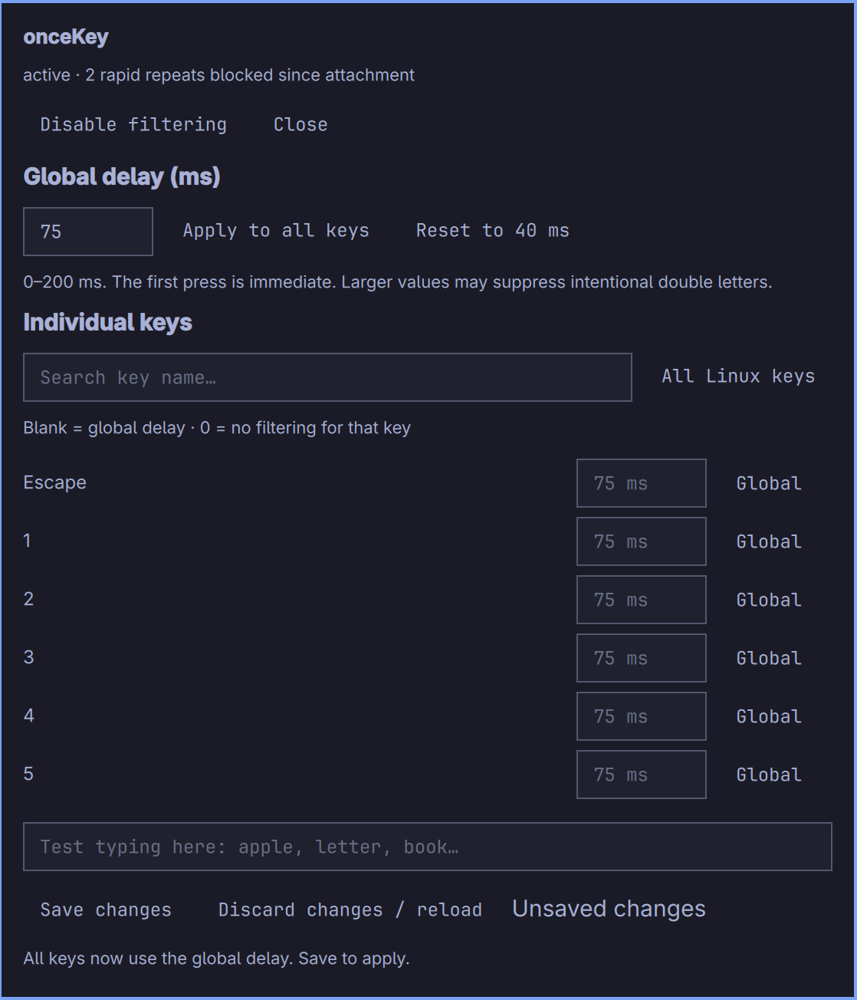

# onceKey

**One intended press. One letter.**

onceKey reduces accidental repeated characters caused by keyboard switch chatter
on supported MacBooks running Omarchy. It combines a small Rust input filter with
an Omarchy settings panel for global and individual-key delays.

## The problem it addresses

Some older MacBooks with Apple's butterfly keyboard register two or more presses
when you physically press a key once. You might type `hello` and see `helllo`, or
get an extra space or repeated punctuation. This is often called **keyboard
chatter**, **switch bounce**, or the **double-key-press problem**.

[Unshaky](https://github.com/aahung/Unshaky) mitigates this problem on macOS by
rejecting rapid repeat presses. onceKey brings a similar approach to supported
Apple keyboards on Linux/Omarchy. It is independently implemented, not an official
Unshaky port, and is not affiliated with Apple or Unshaky.

### What happens when you type?

With a 40 ms delay, a key's first press goes through immediately. A press of
**that same key** less than 40 ms after its last press or release is suppressed,
together with its release. Timing from the release matters because chatter usually
arrives just after the key comes up, however long it was held.
Different keys are independent. Normal held-key repeat is preserved for accepted
presses. There is no 40 ms wait before the first letter appears.

This is a software mitigation, not a hardware repair. It cannot recover missed
presses, fix a physically stuck key, or reliably identify every accidental press.
Too large a delay can suppress intentional double letters, so tune conservatively.

## Screenshots



*Real panel capture showing an unsaved 75 ms example. The shipped default is 40 ms;
75 ms is not a universal recommendation. No setting was saved for this capture.*


## Features

- Global delay from **0–200 ms**, plus individual-key overrides.
- Set **0** to exempt a key; leave blank to inherit the global delay.
- Apply one value to all keys, reset defaults, or discard unsaved edits.
- Search the built-in key catalog, with an expanded Linux-key catalog available.
- Live aggregate suppressed-press count and an unsaved typing-test field.
- Icon-only bar control; click to configure or enable/disable filtering.
- Persistent configuration and boot startup through a systemd service.
- Native Rust filter; no Python runtime, cloud service, or typing telemetry.

## Supported hardware and desktop

Currently targets **only** an input device named `Apple SPI Keyboard` whose physical
path is `applespi/input0`. Check with:

```sh
cat /proc/bus/input/devices
```

Look for `N: Name="Apple SPI Keyboard"` and `P: Phys=applespi/input0` in the same
entry. The current implementation does not match by marketing model/year.
**USB/T2 MacBooks and other keyboard transports are not supported.** Expanding the
key catalog does not expand hardware support. External keyboards and the touchpad
are not intercepted.

The panel requires **Omarchy Quattro / its Quickshell plugin API**. The filter uses
Linux evdev/uinput, systemd, and administrator access. It runs independently of
the bar, including at the lock screen. Physical Caps Lock LED synchronization is
not supported in this version.

## Install

The Omarchy plugin supplies the settings UI. **The input filter requires a separate
build and administrator installation**; adding the bar plugin alone does not fix
keyboard chatter. This is a manual-setup plugin.

After the repository is published:

```sh
omarchy plugin add https://github.com/jimg4/oncekey --enable
cd ~/.config/omarchy/plugins/dimef.oncekey
```

For a local source checkout, run the following from its root:

```sh
omarchy pkg add rust
# A C linker is also required; install base-devel if your system has none.
cargo build --release --locked
sudo bash ./install.sh
# For an external local checkout only (skip if already in the plugin directory):
# mkdir -p ~/.config/omarchy/plugins/dimef.oncekey
# cp manifest.json Widget.qml SettingsModel.js KeyCatalog.js ~/.config/omarchy/plugins/dimef.oncekey/
omarchy-shell shell rescanPlugins
omarchy plugin enable dimef.oncekey --section right
```

The installer copies the service and compiled executable to root-owned system paths.
Rust/Cargo are build dependencies only; no Python or interpreter is used at runtime.
Dependency versions are pinned in Cargo.lock.
The service runs at boot independently of the shell, including on the lock
screen. No broadly writable input-device permissions or input-group membership
are added. Requires Linux uinput. A graphical caller can use `pkexec bash`
with the absolute installer path in place of `sudo bash`.

## Use

- The bar shows a keyboard icon, dimmed when filtering is inactive.
- Hover shows attachment status and duplicate-press count since attachment.
- Click opens the settings panel (right-click does too).
- Set any global delay from 0–200 ms. Existing individual overrides stay intact.
- “Apply to all keys” clears individual overrides so all keys use that global value.
- Search individual keys and enter their delay. Blank / “Global” inherits the global
  delay; 0 disables debounce for that key. “All Linux keys” expands the catalog.
- “Save changes” validates and persists the full configuration in one operation.
  Authentication is requested once per save; cancellation retains your draft.
- “Discard changes / reload” restores saved settings. “Reset to 40 ms” prepares
  a clean default configuration, which is only applied when you save.
- The enable/disable button controls filtering and automatic startup at boot.
- Test typing in the panel; the test text is never saved.
- Start low; increase only if chatter persists. Larger values may suppress
  intentional double letters. Test words such as `apple`, `letter`, and `book`.

```sh
sudo oncekeyctl set-delay 40
sudo oncekeyctl stop
sudo oncekeyctl start
systemctl status oncekey.service
journalctl -u oncekey.service -b
```

The panel saves `/etc/oncekey.json`. Advanced users can also edit it as
administrator and restart the service. `key_delays_ms` maps numeric Linux keycodes to 0–200 ms intervals;
for example `"30": 60` tunes KEY_A and `"42": 0` exempts left Shift. Default
`delay_ms` applies to all other keys. Keycodes refer to physical keys before
the desktop keyboard layout. No typed characters or per-key statistics are
written to disk; only aggregate counts and service errors are exposed.

The daemon releases its exclusive device grab on exit. On disconnect or input
queue overflow it recreates the virtual keyboard with fresh state. Stop/start
and delay changes briefly recreate that keyboard; release keys before changing
settings. An external keyboard remains available for recovery. If input breaks,
stop the service from a terminal, external keyboard, or SSH with
`sudo systemctl disable --now oncekey.service`.

Disabling/removing the bar plugin only removes its UI; stop the service first
to disable filtering. To uninstall the system filter from the source directory:

```sh
sudo bash ./uninstall.sh
omarchy plugin remove dimef.oncekey --yes
```

The uninstaller retains `/etc/oncekey.json` so your tuning survives a
reinstall. Use `sudo bash ./uninstall.sh --purge` to remove it too.

## Verify

```sh
cargo test --locked
cargo clippy --all-targets --locked -- -D warnings
omarchy plugin validate .
```

Synthetic tests exercise debounce timing and balanced key transitions. Physical
typing, suspend/resume, and compositor/TTY behavior still need live checks
on the target machine. Input integration follows the
[Rust evdev API](https://docs.rs/evdev/0.13.2/evdev/).

The event loop sleeps in `poll` until input arrives (250 ms timeout for shutdown
and status updates), so it does not continuously poll the keyboard. Debounce
uses kernel monotonic timestamps and fixed arrays, with no allocation in the
per-key decision. Pending events retain their SYN_REPORT frame boundaries.
No latency benchmark has been run; the 40 ms setting is a rejection window,
not an added delay before accepting the first press.

Known limitation: this evdev version does not expose virtual LED capabilities,
so the physical Caps Lock indicator is not synchronized while filtering.
Caps Lock key events are still forwarded normally.

## License and acknowledgments

MIT; see [LICENSE](LICENSE). Rust dependencies retain their own licenses; see
[THIRD_PARTY.md](THIRD_PARTY.md). Inspired by Unshaky’s documented behavior.
